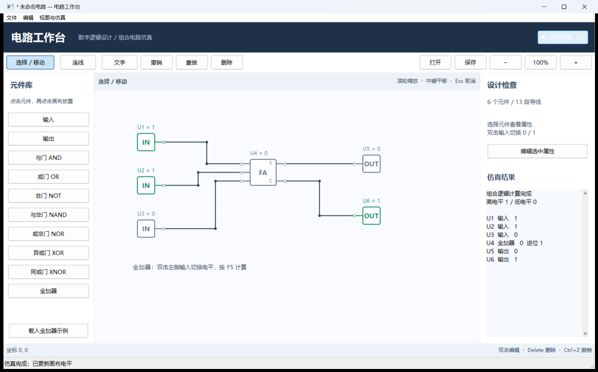
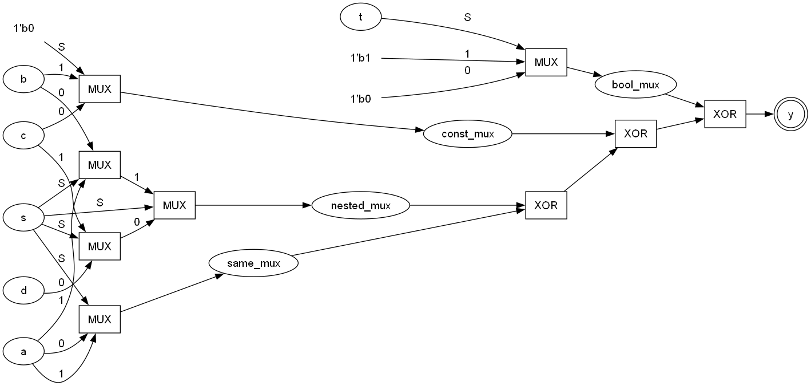
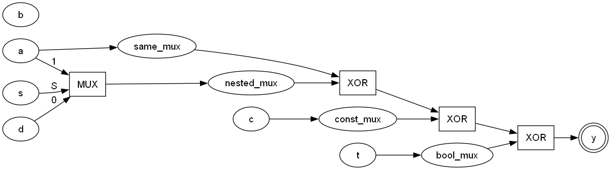
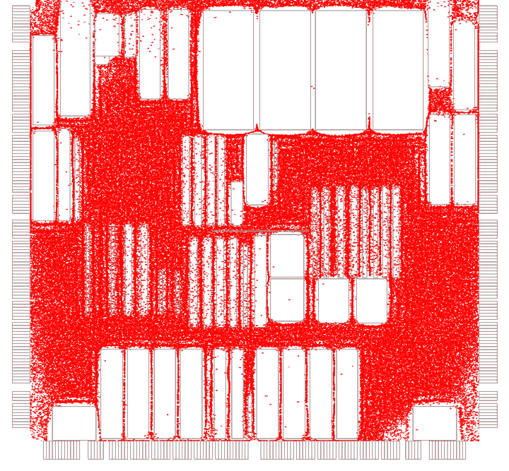
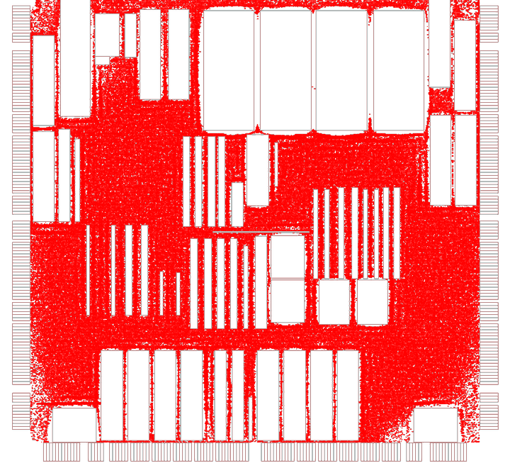

# UESTC Comprehensive Design I / II / III — EDA Course Projects

[](https://github.com/baiyujing-rain/uestc-comprehensive-design/actions/workflows/ci.yml)
[](LICENSE)
[](README.md)

Three semester projects from the *Industrial Software Innovation Training* course at UESTC, covering three layers of an EDA toolchain: **schematic editing & simulation** → **Verilog front-end & logic optimization** → **chip placement**. Everything is implemented from scratch, with no proprietary code.

| Directory | Project | What it does | Stack |
| --- | --- | --- | --- |
| [`01-circuit-workbench`](01-circuit-workbench) | Circuit Workbench | Draw digital circuits, wire them, press F5 and simulate | C++17 · wxWidgets |
| [`02-verilog-frontend`](02-verilog-frontend) | Verilog Front-end | Verilog → AST → optimizations → DOT / RTLIL / Yosys plugin | C++11 · Yosys |
| [`03-myplacement`](03-myplacement) | MyPlacement | ePlace global placement + Abacus legalization, tested on 210k cells | C++14 · CMake · Eigen |

---

## 01 · Circuit Workbench

A wxWidgets schematic editor with a component library, orthogonal wire routing, steady-state combinational logic simulation, `.circuit` / `.net` persistence and SPICE export. The screenshot below shows the built-in full-adder example: inputs 1+1+0 produce sum 0 and carry 1.



- **Run it**: `bin/CircuitWorkbench.exe` (Windows, prebuilt and included)
- **Build it**: `build.ps1` (VS2022 + wxWidgets 3.2.2.1, x64 Debug static)
- **Quality**: 63 regression checks, see [`regression.txt`](01-circuit-workbench/regression.txt)

## 02 · Verilog Front-end and Logic Optimization

A hand-written lexer/parser turns a Verilog subset into an AST, applies `opt_muxtree` / `opt_expr` style algebraic optimizations, and emits Graphviz netlists plus RTLIL. It also builds as a **Yosys front-end plugin** that replaces `read_verilog`. Before / after netlists of the same circuit:

| Before | After |
| --- | --- |
|  |  |

- **Build**: `make all` (g++ / MinGW); for the Yosys plugin on Ubuntu: `make plugin`
- **Usage**: `./netlist_to_dot.exe --no-opt test.v before.dot` and `./netlist_to_dot.exe test.v after.dot`

## 03 · MyPlacement

A complete placement pipeline: BookShelf parsing → three initial placers → ePlace global placement (WA wirelength + electrostatic density + Nesterov) → BMP / GDSII visualization → Abacus legalization, plus a Flask web UI. Measured on `adaptec1` (210k cells, 220k nets):

| Global placement (HPWL 1.41e8) | After Abacus legalization |
| --- | --- |
|  |  |

- **Build**: `cmake -S . -B build -G Ninja -DCMAKE_BUILD_TYPE=Release && cmake --build build` (Linux / WSL)
- **Run**: `./build/myplace --fast data/thin1.aux`
- **Live demo**: deploy the Flask UI to Render with one click →

  [](https://render.com/deploy?repo=https://github.com/baiyujing-rain/uestc-comprehensive-design)

---

## Repository layout

```
01-circuit-workbench/     schematic editor: source + prebuilt exe + docs/
02-verilog-frontend/      Verilog front-end: source + sample circuits + ui_assets/
03-myplacement/           MyPlacement: algorithms + third_party + data + web/
.github/workflows/ci.yml  CI: builds the Verilog front-end and MyPlacement, runs samples
render.yaml               one-click web demo deployment (Render Blueprint)
```

## Documentation notes

Course reports (mid-term / final reports, slides) are **not** included: they contain teammates' names, student IDs and the instructor's contact details. Only the assignment documents without personal data are kept (`docs/` in each project).

## License

MIT — see [LICENSE](LICENSE). The course assignment documents under each `docs/` folder belong to UESTC and the course team and are **not** covered by the MIT license.
