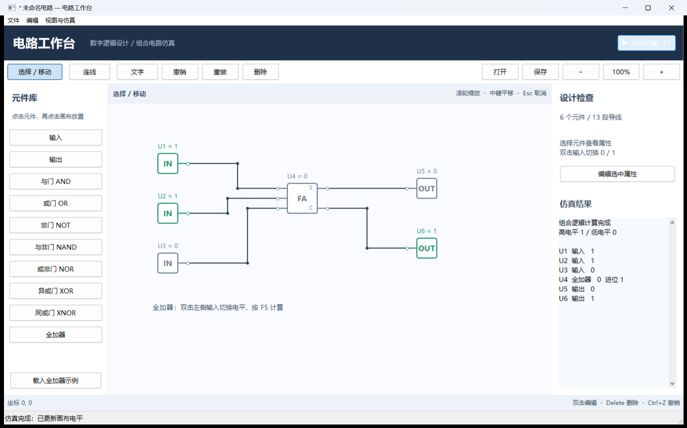
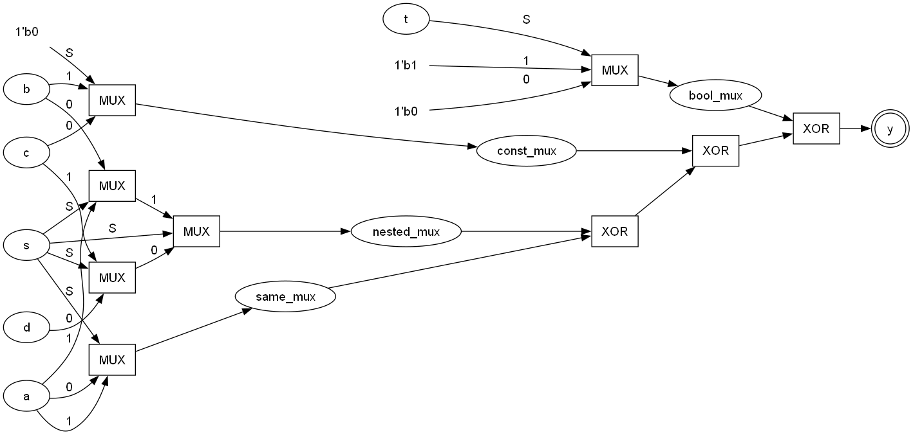
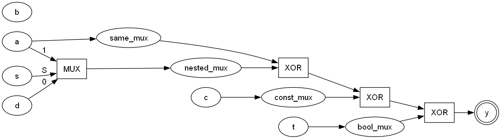
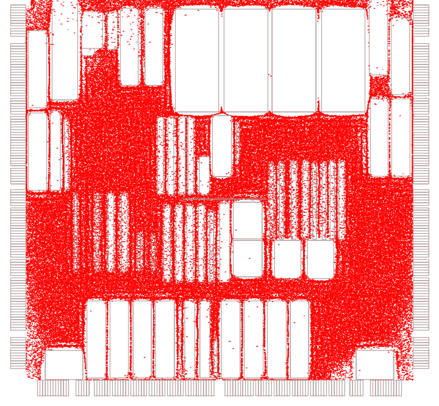
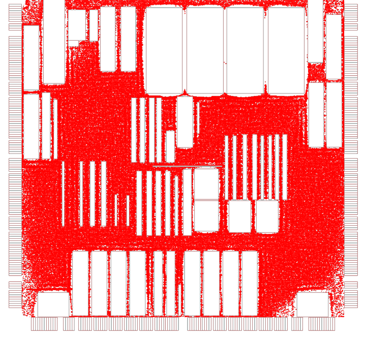

# 综合设计 I / II / III · EDA 方向课程项目合集

[](https://github.com/baiyujing-rain/uestc-comprehensive-design/actions/workflows/ci.yml)
[](LICENSE)
[](README.en.md)

电子科技大学「工业软件创新训练 / 进阶式挑战性综合项目」三个学期的综合设计，覆盖 EDA 工具链的三个层次：**数字电路编辑与仿真** → **Verilog 编译与逻辑优化** → **芯片布局（Placement）**。全部从零实现，不含任何商业代码。

| 目录 | 项目 | 一句话 | 技术栈 |
| --- | --- | --- | --- |
| [`01-circuit-workbench`](01-circuit-workbench) | 电路工作台 | 画数字电路、连线、按 F5 出结果 | C++17 · wxWidgets |
| [`02-verilog-frontend`](02-verilog-frontend) | Verilog 前端 | 解析 Verilog → AST 优化 → DOT / RTLIL / Yosys 插件 | C++11 · Yosys |
| [`03-myplacement`](03-myplacement) | MyPlacement | ePlace 全局布局 + Abacus 合法化，21 万单元实测 | C++14 · CMake · Eigen |

---

## 01 · 电路工作台

数字电路可视化编辑器：元件库拖放、正交折线连线、组合逻辑稳态仿真、`.circuit` / `.net` 读写与 SPICE 导出。下方是全加器示例，输入 1+1+0，右侧实时给出和 0、进位 1。



- **直接运行**：`bin/CircuitWorkbench.exe`（Windows，随仓库附带）
- **自行构建**：`build.ps1`（VS2022 + wxWidgets 3.2.2.1 x64 Debug 静态库）
- **质量**：63 项回归检查，见 [`regression.txt`](01-circuit-workbench/regression.txt)
- 详细说明 → [01-circuit-workbench/README.md](01-circuit-workbench/README.md)

## 02 · Verilog 前端与逻辑优化

手写词法 / 语法分析把 Verilog 子集解析成 AST，做 `opt_muxtree`、`opt_expr` 风格的代数优化，输出 Graphviz 网表与 RTLIL，并可编译成 **Yosys 前端插件**替换 `read_verilog`。下面是同一电路优化前 / 后的网表对比：

| 优化前 | 优化后 |
| --- | --- |
|  |  |

- **构建**：`make all`（g++ / MinGW）；Yosys 插件在 Ubuntu 下 `make plugin`
- **用法**：`./netlist_to_dot.exe --no-opt test.v before.dot` / `./netlist_to_dot.exe test.v after.dot`
- 详细说明 → [02-verilog-frontend/README.md](02-verilog-frontend/README.md)

## 03 · MyPlacement 芯片布局工具链

完整 Placement 流水线：BookShelf 解析 → 三种初始布局 → ePlace 全局布局（WA 线长 + 静电密度 + Nesterov）→ BMP / GDSII 可视化 → Abacus 合法化，附带 Flask 可视化前端。实测 `adaptec1`（21 万单元 / 22 万网络）：

| 全局布局（HPWL 1.41e8） | Abacus 合法化后 |
| --- | --- |
|  |  |

- **构建**：`cmake -S . -B build -G Ninja -DCMAKE_BUILD_TYPE=Release && cmake --build build`（Linux / WSL）
- **运行**：`./build/myplace --fast data/thin1.aux`
- **在线演示**：Web 前端可一键部署到 Render →

  [](https://render.com/deploy?repo=https://github.com/baiyujing-rain/uestc-comprehensive-design)

- 详细说明 → [03-myplacement/README.md](03-myplacement/README.md)

---

## 仓库结构

```
01-circuit-workbench/     电路工作台：源码 + 预编译 exe + docs/（任务书）
02-verilog-frontend/      Verilog 前端：源码 + 示例电路 + ui_assets/ + docs/（任务描述）
03-myplacement/           MyPlacement：算法源码 + third_party + data + web/ + docs/（任务描述）
.github/workflows/ci.yml  CI：编译 Verilog 前端与 MyPlacement 并跑示例
render.yaml               一键部署 Web 演示（Render Blueprint）
```

## 快速验证

```bash
# 02：编译三个命令行工具并跑一个示例
cd 02-verilog-frontend && make all && ./myverilog_parser.exe test.v | head -20

# 03：编译并跑玩具数据集
cd 03-myplacement && cmake -S . -B build -G Ninja -DCMAKE_BUILD_TYPE=Release \
  && cmake --build build && ./build/myplace --fast data/thin1.aux
```

## 文档

本仓库**不收录课程报告**（中期/总结报告、汇报 PPT 等），因为其中含小组成员姓名、学号与指导教师联系方式。只保留不含个人信息的任务文档：

| 项目 | 文档 |
| --- | --- |
| 综合设计 I | [`课题任务书.docx`](01-circuit-workbench/docs/课题任务书.docx) |
| 综合设计 II | [`任务描述.pdf`](02-verilog-frontend/docs/任务描述.pdf) |
| 综合设计 III | [`任务描述.pdf`](03-myplacement/docs/任务描述.pdf) |

综合设计 II、III 的《课题任务书》写有指导教师姓名、电话与邮箱，未收录。

## 仓库约定

- 三个项目保留原来的目录结构与构建脚本，克隆后可直接按各自 README 构建。
- 不含构建产物（`.vs/`、`x64/`、`build/`、`output/`）、本机配置（`*.user`）与运行产物。
- 例外：`01-circuit-workbench/bin/CircuitWorkbench.exe` 与 `02-verilog-frontend` 下的三个 `.exe` 是为方便直接演示而保留的预编译 Windows 程序。

## 许可

本项目以 [MIT License](LICENSE) 发布，欢迎学习与参考。仓库中收录的课程任务文档版权归电子科技大学及课程组所有，不在 MIT 许可范围内，请勿再分发。
